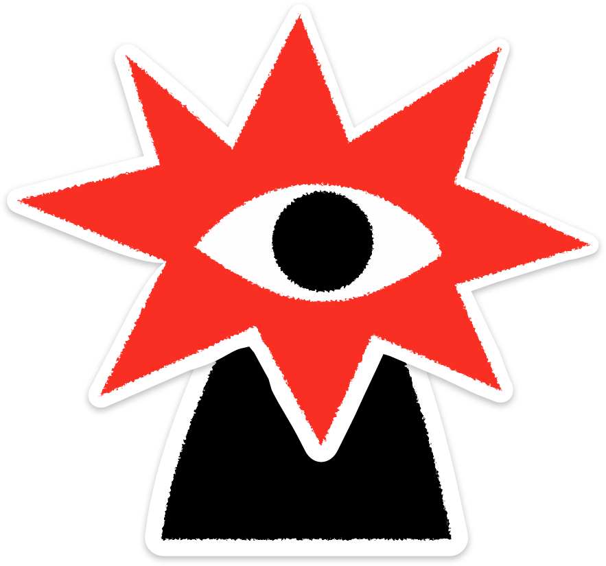

<div align="center">
  
  <h1>Stick It Up</h1>
  <p><strong>Give your website the kind of personality it deserves.</strong></p>
  <p>A curated collection of 148 handcrafted vector sticker components for React & Next.js with realistic 3D vinyl peel physics.</p>

  <p>
    <a href="https://www.npmjs.com/package/stick-it-up">
      
    </a>
    <a href="https://www.npmjs.com/package/stick-it-up">
      
    </a>
    <a href="LICENSE">
      
    </a>
    <a href="https://react.dev">
      
    </a>
    <a href="https://nextjs.org">
      
    </a>
    <a href="https://www.typescriptlang.org">
      
    </a>
  </p>

  <p>
    <a href="#-quick-start">Quick Start</a> •
    <a href="#-available-stickers">Stickers Catalog</a> •
    <a href="#-props-reference">Props</a> •
    <a href="#-local-development">Development</a> •
    <a href="#-contributing">Contributing</a> •
    <a href="#-license">License</a>
  </p>
</div>

---

## 🌟 Highlights

- 🎨 **34 Handcrafted Stickers**: Editable vector faces, pandas, winter animals, Christmas characters, and cute kawaii designs.
- 🪄 **3D Vinyl Peel Physics**: Realistic hover tilt, subtle drop shadows, and elevation with a single `peel` prop.
- 🔒 **Zero ID Collisions**: Scoped SVG filter and gradient IDs powered by React's `useId()` so duplicate stickers never break each other.
- 🌲 **Tree-Shakeable & Lightweight**: Pure ESM and CommonJS dual bundle with full TypeScript definitions and zero runtime CSS dependencies.
- 🚀 **Dual Usage**: Use lightweight direct named component imports (`<PandaBear1Sticker />`) or dynamic name-based rendering (`<Sticker name="face" />`).
- 🖥️ **Interactive Web Showcase**: Full Next.js showcase app featuring live dragging, interactive inspection modal, quickstart code generator, and instant SVG downloads.

---

## 📦 Installation

Install the package via your package manager of choice:

```bash
# npm (recommended: use @latest)
npm install stick-it-up@latest

# pnpm
pnpm add stick-it-up@latest

# bun
bun add stick-it-up@latest

# yarn
yarn add stick-it-up@latest
```

---

## 🚀 Quick Start

### 1. Named Component Import (Recommended for minimal bundle size)

Every sticker is exported as a standalone, tree-shakeable React component:

```tsx
import { FaceSticker, PandaBear1Sticker, PandaGarlandSticker } from "stick-it-up";

export default function Hero() {
  return (
    <div className="flex items-center gap-6">
      <FaceSticker size={100} />
      <PandaBear1Sticker size={120} peel />
      <PandaGarlandSticker size={96} peel />
    </div>
  );
}
```

### 2. Dynamic Component (`<Sticker name="..." />`)

Need to dynamically display stickers based on state, props, or CMS data? Use the generic `<Sticker />` component:

```tsx
import { Sticker, type StickerName } from "stick-it-up";

const featured: StickerName[] = [
  "face",
  "panda-bear-1",
  "panda-garland",
  "panda-sack",
  "forest-animal-4",
  "halloween-face-3",
];

export default function StickerGrid() {
  return (
    <div className="grid grid-cols-4 gap-4">
      {featured.map((name) => (
        <Sticker key={name} name={name} size={96} peel />
      ))}
    </div>
  );
}
```

### 3. Using Raw SVGs

All SVGs are also available directly in the `public/stickers/` folder for use in plain HTML or standard `` tags:

```html

```

---

## ⚙️ Props Reference

All sticker components accept standard SVG element props alongside custom sticker attributes:

| Prop | Type | Default | Description |
| :--- | :--- | :--- | :--- |
| `size` | `number \| string` | `100` | Symmetrical width and height in pixels (e.g., `96` or `"120px"`). |
| `peel` | `boolean` | `false` | Enables 3D vinyl peel hover physics (tilt, lift, and soft sticker shadow). |
| `name` | `StickerName` | — | Required **only** when using the generic `<Sticker name="..." />` component. |
| `width` | `number \| string` | — | Overrides `size` for explicit custom width. |
| `height` | `number \| string` | — | Overrides `size` for explicit custom height. |
| `className` | `string` | `""` | Additional CSS classes for rotation, positioning, or custom animations. |
| `style` | `React.CSSProperties` | — | Inline style overrides (automatically merged with peel animation styles). |
| `...props` | `React.SVGProps` | — | Any other standard SVG attributes (`role`, `aria-label`, `onClick`, etc.). |

---

## 🎨 Available Stickers (148 Total)

### 🎭 Characters, Pandas & Winter (104 stickers)
- `face` (`<FaceSticker />`)
- `panda-bear-1` (`<PandaBear1Sticker />`)
- `panda-bear-2` (`<PandaBear2Sticker />`)
- `panda-garland` (`<PandaGarlandSticker />`)
- `panda-sack` (`<PandaSackSticker />`)
- `winter-doodle-4` (`<WinterDoodle4Sticker />`)
- `xmas-character-1` (`<XmasCharacter1Sticker />`)
- `xmas-character-4` (`<XmasCharacter4Sticker />`)
- `forest-animal-4` (`<ForestAnimal4Sticker />`)
- `samurai-boy-1` (`<SamuraiBoy1Sticker />`)
- `ninja-airbender-1` (`<NinjaAirbender1Sticker />`)
- `kimono-katana-boy-1` (`<KimonoKatanaBoy1Sticker />`)
- `ninja-sitting-1` (`<NinjaSitting1Sticker />`)
- `japanese-merchant-1` (`<JapaneseMerchant1Sticker />`)
- `costume-kid-2` (`<CostumeKid2Sticker />`)
- `costume-kid-3` (`<CostumeKid3Sticker />`)
- `costume-kid-6` (`<CostumeKid6Sticker />`)
- `gamer-man` (`<GamerManSticker />`)
- `retro-basketball-1` (`<RetroBasketball1Sticker />`)
- `retro-basketball-2` (`<RetroBasketball2Sticker />`)
- `retro-basketball-4` (`<RetroBasketball4Sticker />`)
- `retro-cartoon-1` (`<RetroCartoon1Sticker />`)
- `retro-cartoon-2` (`<RetroCartoon2Sticker />`)
- `retro-cartoon-3` (`<RetroCartoon3Sticker />`)
- `retro-military-1` (`<RetroMilitary1Sticker />`)
- `retro-military-2` (`<RetroMilitary2Sticker />`)
- `retro-military-3` (`<RetroMilitary3Sticker />`)
- `retro-military-4` (`<RetroMilitary4Sticker />`)
- `retro-military-5` (`<RetroMilitary5Sticker />`)
- `retro-military-6` (`<RetroMilitary6Sticker />`)
- `retro-military-7` (`<RetroMilitary7Sticker />`)
- `retro-military-8` (`<RetroMilitary8Sticker />`)
- `rock-sticker-2` (`<RockSticker2Sticker />`)
- `rock-sticker-3` (`<RockSticker3Sticker />`)
- `rock-sticker-4` (`<RockSticker4Sticker />`)
- `young-action-2` (`<YoungAction2Sticker />`)
- `young-action-3` (`<YoungAction3Sticker />`)
- `young-action-4` (`<YoungAction4Sticker />`)
- `young-action-5` (`<YoungAction5Sticker />`)
- `young-action-6` (`<YoungAction6Sticker />`)
- `funny-character-3` (`<FunnyCharacter3Sticker />`)
- `funny-character-4` (`<FunnyCharacter4Sticker />`)
- `funny-character-5` (`<FunnyCharacter5Sticker />`)
- `funny-character-6` (`<FunnyCharacter6Sticker />`)
- `funny-character-7` (`<FunnyCharacter7Sticker />`)
- `funny-character-8` (`<FunnyCharacter8Sticker />`)
- `rock-sticker-5` (`<RockSticker5Sticker />`)
- `rock-sticker-6` (`<RockSticker6Sticker />`)
- `rock-sticker-7` (`<RockSticker7Sticker />`)
- `rock-sticker-8` (`<RockSticker8Sticker />`)
- `wrestler-4` (`<Wrestler4Sticker />`)
- `wrestler-6` (`<Wrestler6Sticker />`)
- `funny-doodle-1` (`<FunnyDoodle1Sticker />`)
- `funny-doodle-2` (`<FunnyDoodle2Sticker />`)
- `funny-doodle-3` (`<FunnyDoodle3Sticker />`)
- `funny-doodle-4` (`<FunnyDoodle4Sticker />`)
- `graffiti-tag-1` (`<GraffitiTag1Sticker />`)
- `graffiti-tag-4` (`<GraffitiTag4Sticker />`)
- `graffiti-tag-16` (`<GraffitiTag16Sticker />`)
- `cute-pop-1` (`<CutePop1Sticker />`)
- `doodle-beast-1` (`<DoodleBeast1Sticker />`)
- `doodle-beast-2` (`<DoodleBeast2Sticker />`)
- `doodle-beast-3` (`<DoodleBeast3Sticker />`)
- `doodle-beast-4` (`<DoodleBeast4Sticker />`)
- `doodle-beast-5` (`<DoodleBeast5Sticker />`)
- `doodle-beast-6` (`<DoodleBeast6Sticker />`)
- `doodle-beast-7` (`<DoodleBeast7Sticker />`)
- `doodle-beast-8` (`<DoodleBeast8Sticker />`)
- `doodle-beast-9` (`<DoodleBeast9Sticker />`)
- `pattern-monster-1` (`<PatternMonster1Sticker />`)
- `pattern-monster-2` (`<PatternMonster2Sticker />`)
- `pattern-monster-3` (`<PatternMonster3Sticker />`)
- `pattern-monster-4` (`<PatternMonster4Sticker />`)
- `pattern-monster-5` (`<PatternMonster5Sticker />`)
- `pattern-monster-6` (`<PatternMonster6Sticker />`)
- `retro-badge-1` (`<RetroBadge1Sticker />`)
- `retro-badge-2` (`<RetroBadge2Sticker />`)
- `retro-badge-3` (`<RetroBadge3Sticker />`)
- `retro-badge-4` (`<RetroBadge4Sticker />`)
- `retro-badge-5` (`<RetroBadge5Sticker />`)
- `retro-badge-6` (`<RetroBadge6Sticker />`)
- `plant-buddy-1` (`<PlantBuddy1Sticker />`)
- `plant-buddy-2` (`<PlantBuddy2Sticker />`)
- `plant-buddy-3` (`<PlantBuddy3Sticker />`)
- `funny-sketch-3` (`<FunnySketch3Sticker />`)
- `funny-sketch-4` (`<FunnySketch4Sticker />`)
- `happy-doodle-1` (`<HappyDoodle1Sticker />`)
- `happy-doodle-2` (`<HappyDoodle2Sticker />`)
- `happy-doodle-4` (`<HappyDoodle4Sticker />`)
- `mad-beast-1` (`<MadBeast1Sticker />`)
- `mad-beast-2` (`<MadBeast2Sticker />`)
- `mad-beast-3` (`<MadBeast3Sticker />`)
- `mad-beast-4` (`<MadBeast4Sticker />`)
- `decor-sticker-1` (`<DecorSticker1Sticker />`)
- `decor-sticker-2` (`<DecorSticker2Sticker />`)
- `decor-sticker-3` (`<DecorSticker3Sticker />`)
- `decor-sticker-5` (`<DecorSticker5Sticker />`)
- `decor-sticker-6` (`<DecorSticker6Sticker />`)
- `lol-fun-1` (`<LolFun1Sticker />`)
- `lol-fun-2` (`<LolFun2Sticker />`)
- `lol-fun-3` (`<LolFun3Sticker />`)
- `lol-fun-4` (`<LolFun4Sticker />`)
- `lol-fun-5` (`<LolFun5Sticker />`)
- `lol-fun-6` (`<LolFun6Sticker />`)

### 🎃 Halloween Characters & Watercolor (31 stickers)
- `halloween-face-3` (`<HalloweenFace3Sticker />`)
- `halloween-sketch-4` (`<HalloweenSketch4Sticker />`)
- `halloween-prop-1` (`<HalloweenProp1Sticker />`)
- `cute-monster-1` (`<CuteMonster1Sticker />`)
- `cute-monster-2` (`<CuteMonster2Sticker />`)
- `cute-monster-3` (`<CuteMonster3Sticker />`)
- `cute-monster-5` (`<CuteMonster5Sticker />`)
- `cute-monster-6` (`<CuteMonster6Sticker />`)
- `watercolor-character-1` (`<WatercolorCharacter1Sticker />`)
- `watercolor-character-3` (`<WatercolorCharacter3Sticker />`)
- `watercolor-character-4` (`<WatercolorCharacter4Sticker />`)
- `watercolor-kid-2` (`<WatercolorKid2Sticker />`)
- `watercolor-kid-3` (`<WatercolorKid3Sticker />`)
- `watercolor-kid-5` (`<WatercolorKid5Sticker />`)
- `watercolor-kid-6` (`<WatercolorKid6Sticker />`)
- `watercolor-halloween-3` (`<WatercolorHalloween3Sticker />`)
- `watercolor-halloween-5` (`<WatercolorHalloween5Sticker />`)
- `handdrawn-kid-1` (`<HanddrawnKid1Sticker />`)
- `handdrawn-kid-3` (`<HanddrawnKid3Sticker />`)
- `handdrawn-kid-4` (`<HanddrawnKid4Sticker />`)
- `frankenstein-boy-1` (`<FrankensteinBoy1Sticker />`)
- `creepy-character-2` (`<CreepyCharacter2Sticker />`)
- `creepy-character-3` (`<CreepyCharacter3Sticker />`)
- `creepy-character-4` (`<CreepyCharacter4Sticker />`)
- `chinese-vampire-1` (`<ChineseVampire1Sticker />`)
- `cute-halloween-buddy-2` (`<CuteHalloweenBuddy2Sticker />`)
- `cute-halloween-buddy-5` (`<CuteHalloweenBuddy5Sticker />`)
- `happy-halloween-3` (`<HappyHalloween3Sticker />`)
- `happy-halloween-4` (`<HappyHalloween4Sticker />`)
- `happy-halloween-5` (`<HappyHalloween5Sticker />`)
- `happy-halloween-8` (`<HappyHalloween8Sticker />`)

### 👹 Monster Faces & Head Icons (9 stickers)
- `monster-face-1` (`<MonsterFace1Sticker />`)
- `monster-face-2` (`<MonsterFace2Sticker />`)
- `monster-face-3` (`<MonsterFace3Sticker />`)
- `monster-face-7` (`<MonsterFace7Sticker />`)
- `monster-face-8` (`<MonsterFace8Sticker />`)
- `monster-face-9` (`<MonsterFace9Sticker />`)
- `monster-icon-1` (`<MonsterIcon1Sticker />`)
- `monster-icon-3` (`<MonsterIcon3Sticker />`)
- `monster-icon-5` (`<MonsterIcon5Sticker />`)

### 🕹️ Retro Videogame Characters (4 stickers)
- `videogame-collection-1` (`<VideogameCollection1Sticker />`)
- `videogame-collection-2` (`<VideogameCollection2Sticker />`)
- `videogame-set-3` (`<VideogameSet3Sticker />`)
- `videogame-set-4` (`<VideogameSet4Sticker />`)

---

## 💻 Local Development

The repository is structured as an npm workspaces monorepo:

```
components/
├── app/                      # Next.js showcase web application
│   ├── page.tsx              # Landing page with interactive drag & drop
│   └── stickers/             # Full stickers catalog & documentation
├── components/               # Landing page UI sections
├── packages/
│   └── stickers-react/       # The "stick-it-up" npm package source
│       ├── src/
│       │   ├── stickers/     # All 148 sticker React components
│       │   ├── components/   # Generic <Sticker /> wrapper
│       │   └── utils/        # usePeel hover hook
│       └── tsup.config.ts    # Package build config (CJS, ESM, DTS)
└── public/
    └── stickers/             # Raw SVG assets
```

### Running Locally

1. Clone the repository:
   ```bash
   git clone https://github.com/Sam721166/stick-it-up.git
   cd stick-it-up
   ```

2. Install dependencies:
   ```bash
   npm install
   ```

3. Build the sticker package:
   ```bash
   npm run build:package
   ```

4. Start the Next.js development server:
   ```bash
   npm run dev
   ```

5. Open [http://localhost:3000](http://localhost:3000) to view the live showcase and `/stickers` for the full catalog.

---

## 🤝 Contributing

Contributions from designers and developers are warmly welcomed!

- **Submit Artwork**: Have a cool vector decal or sticker concept? Read our [Contributing Guide](CONTRIBUTING.md) to learn how to add your SVG and React component.
- **Request a Sticker**: Have an idea for a sticker you'd like to see added? [Open a Sticker Request issue](https://github.com/Sam721166/stick-it-up/issues/new?labels=sticker-request&title=[Sticker+Request]:+).
- **Report Bugs**: Encounter an issue with sizing, Peel effects, or imports? [Open an issue on GitHub](https://github.com/Sam721166/stick-it-up/issues).

---

## 💖 Support & Sponsorship

Stick It Up is an independent, 100% free open-source project. If these stickers made your website or app more enjoyable, consider backing future packs and ongoing maintenance:

- **[GitHub Sponsors](https://github.com/sponsors/Sam721166)**: Monthly or one-time sponsorship with profile badges.
- **[Buy Me a Coffee](https://buymeacoffee.com/samirande_)**: Send a quick coffee ($5) via Apple Pay or card with zero setup.

---

## 📄 License & Fair-Use Terms

This project is licensed under the **Stick It Up Fair-Use & Community License** (v1.0, 2026).

### Summary of Terms:

- ✅ **Free & Encouraged**:
  - Install and use in personal projects, developer portfolios, and non-commercial web apps.
  - Study, fork, and explore the codebase to learn motion and UI engineering techniques.
  - Submit bug fixes, features, and new sticker designs back to the community via Pull Requests.

- ❌ **Restrictions**:
  - **No Commercial Paywalls**: You may **not** sell, license, or place this software, its sticker graphics, or derivative components behind a paid paywall, paid subscription, or commercial asset pack.
  - **No Competing Clones / Re-hosting**: You may **not** make minor or trivial modifications to this project and publicly host or republish it as your own competing sticker catalog or package.
  - **Artist Rights**: Character designs and artwork curated in this library remain the intellectual property of their original creators.

For the full legal text, please read the [LICENSE](LICENSE) file.

---

<div align="center">
  <p>Crafted with care by <a href="https://github.com/Sam721166">Samiran De</a> • If you enjoy Stick It Up, give it a ⭐️ on GitHub!</p>
</div>
